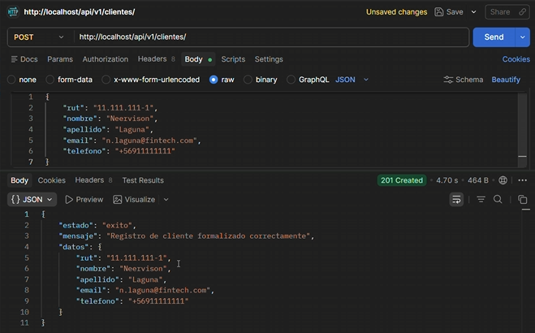
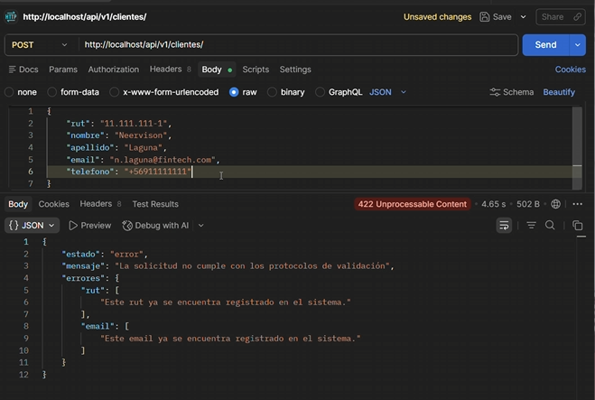
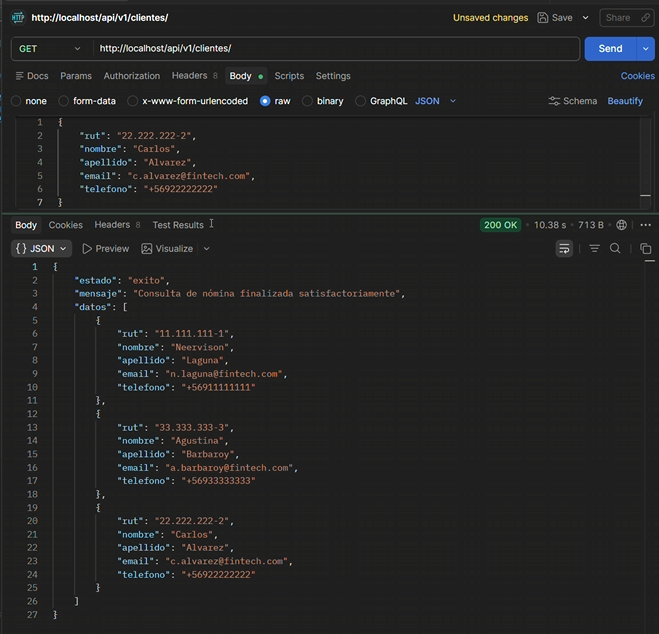

# Core Bancario - Fintech Solutions S.A.

**Evaluación Sumativa 2:** El Contrato de Datos  
**Asignatura:** Desarrollo Backend
**Docente:** Patricio Silva Cartes  
**Integrantes:** Carlos Alvarez, Neervison Laguna, Agustina Barbaroy  


## 1. Introducción
 Como equipo, hemos avanzado significativamente desde la fase inicial. Si bien en la primera entrega nos enfocamos en establecer una arquitectura sólida de **Microservicios Contenerizados**, en esta nueva etapa el desarrollo se ha volcado íntegramente en consolidar el **Sprint 1: El Contrato de Datos**. 

 **En este sentido**, el enfoque ya no reside únicamente en que los contenedores "corran", sino en cómo la aplicación procesa, valida y protege la información bancaria. Hemos transformado una infraestructura estática en un sistema inteligente capaz de garantizar que cada dato ingresado cumpla con rigurosos estándares de integridad y seguridad financiera.


## 2. Arquitectura de Microservicios (Docker)
Para asegurar un entorno de ejecución profesional y evitar inconsistencias, mantenemos un ecosistema de tres pilares fundamentales que interactúan de forma orquestada:

* **Servidor Web (Nginx):** Actúa como nuestra puerta de enlace en el puerto 80, gestionando las peticiones HTTP y derivándolas eficientemente mediante el protocolo FastCGI.
* **Servidor de Aplicación (PHP 8.2-FPM):** Contenedor optimizado donde reside la lógica de **Laravel 11**. En esta fase su rol es crítico, actuando como el procesador de reglas de negocio y el primer filtro de seguridad de los datos.
* **Servidor de Base de Datos (MySQL 8.0):** Motor relacional dedicado a la gestión de información. **A diferencia de** otros sistemas, aquí la persistencia es definitiva gracias al uso de volúmenes Docker, asegurando que los datos trasciendan la sesión actual.


## 3. El Contrato de Datos: Diseño RESTful
**Por otro lado**, para cumplir con los estándares internacionales de desarrollo y facilitar la escalabilidad, hemos implementado un versionamiento **v1** en todos nuestros puntos de acceso. **De este modo**, establecemos un contrato de comunicación claro y profesional:

| Método | Endpoint | Descripción | Código Éxito |
| :--- | :--- | :--- | :--- |
| **GET** | `/api/v1/clientes` | Obtención de la cartera completa de clientes. | `200 OK` |
| **GET** | `/api/v1/clientes/{id}` | Consulta quirúrgica de un cliente específico por ID. | `200 OK` |
| **POST** | `/api/v1/clientes` | Registro de nuevos perfiles con validación de integridad. | `201 Created` |


## 4. Lógica de Validación y Manejo de Excepciones Humanizado
**Un aspecto fundamental a destacar** en esta actualización es la humanización del sistema. **Por lo general**, las APIs devuelven errores técnicos en inglés. **Por el contrario**, hemos personalizado el motor de validación para que la comunicación sea **100% en español**.

**En consecuencia**, el sistema protege el Core Bancario de la siguiente manera:
* **Validación de Integridad (422):** Si se intenta duplicar un RUT o Email, la API responde: *"Este RUT ya se encuentra registrado en el sistema"*.
* **Manejo de Ausencia (404):** Si se consulta un ID inexistente en MySQL, el sistema informa: *"El cliente no existe en los registros bancarios"*.


## 5. Características Técnicas del Backend
* **Persistencia Total:** Uso de volúmenes de Docker para garantizar la seguridad de los datos ante reinicios del sistema.
* **Gestión Centralizada:** Implementación de archivos `.env` para proteger credenciales, evitando el *hardcoding* de información sensible.
* **Modularidad:** Separación estricta entre Rutas, Controladores y Modelos, facilitando el mantenimiento a largo plazo.
* **Eficiencia:** Uso de imágenes **Alpine Linux**, lo que reduce drásticamente el peso de los contenedores y acelera el despliegue.


## 6. Guía de Comandos y Mantenimiento
**Por consiguiente**, para poner en marcha esta versión y asegurar que el entorno esté "refrescado" y sincronizado, se deben ejecutar las siguientes instrucciones de orquestación:

### Inicialización y Sincronización
1.  **Levantamiento del Entorno:**
    ```bash
    docker-compose up -d --build
    ```
    *Construye las imágenes y levanta los servicios en segundo plano.*
Usamos este comando para "darle vida" a los contenedores. En este sentido, el parámetro --build es nuestro seguro de vida: nos asegura que cualquier cambio que hayamos hecho en las configuraciones se aplique de inmediato, levantando un entorno fresco y actualizado.

2.  **Limpieza de Caché y Rutas:**
    ```bash
    docker-compose exec app_php php artisan route:clear
    docker-compose exec app_php php artisan config:clear
    ```
    *Obliga a Laravel a leer la última configuración del archivo `.env` y los nuevos endpoints `/api/v1/`.
A veces, el sistema "recuerda" rutas o configuraciones antiguas que ya no existen. Por el contrario, al ejecutar estos comandos, obligamos a Laravel a olvidar el pasado y reconocer nuestros nuevos puntos de acceso v1. Es como refrescar una página web para ver los cambios reales.*

### Refresco de Persistencia (Paso Crítico)
3.  **Ejecución de Migraciones:**
    ```bash
    docker-compose exec app_php php artisan migrate:fresh
    ```
    **¿Por qué usamos este comando?** **A diferencia de** una migración simple, `migrate:fresh` elimina todas las tablas y las recrea desde cero. Esto es fundamental para:
    * **Reiniciar los IDs:** Garantiza que el contador de auto-incremento vuelva a **1**, permitiendo una evidencia limpia.
    * **Integridad Total:** Elimina registros residuales de pruebas previas que podrían causar conflictos con las nuevas reglas de validación.

### Evidencias de Funcionamiento (Postman)

En este sentido, para certificar que el contrato de datos se cumple rigurosamente, se presentan las siguientes pruebas de concepto:

A. Registro Exitoso (201 Created)
Se realiza una petición POST enviando los datos del cliente. El sistema valida la integridad y retorna el objeto creado con su respectivo ID.



B. Validación de Duplicidad (422 Unprocessable Content)
Por el contrario, si intentamos registrar un RUT que ya existe en nuestra base de datos MySQL, el sistema intercepta la petición y responde con un mensaje.



C. Consulta de Cartera (200 OK)
Mediante el método GET, visualizamos la persistencia de los datos almacenados en el contenedor de MySQL.

